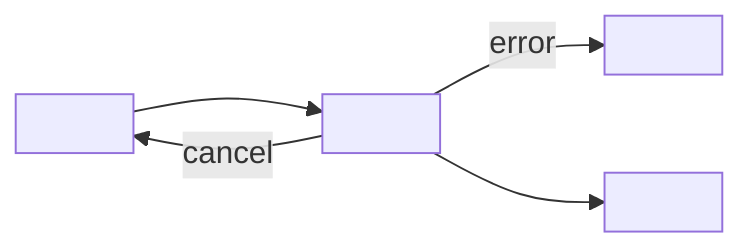

# UI spec

Checked: 2026-10-12. Check the current source when a rule decides an outcome.

Use this for every item with a screen or UI component, before the developer brief. Write `docs/ui/<item>.md` with the template below. The accessibility target is WCAG 2.2 AA. **The PM sees the spec when the screens face users** (show it with the deck for a large item, or on its own for a small one) and approves it before the developer starts.

A spec without a full states matrix, breakpoints (including 320 px) and accessibility notes is incomplete: the developer will stop and send it back.

## UI spec template (`docs/ui/<item>.md`)

Fill every section. Write `n/a — <reason>` in a cell or section that doesn't apply; never leave one blank.

````markdown
# <Item> — UI spec

Date: <YYYY-MM-DD> — Design note: <link or n/a> — Status: draft, waiting for PM

## User and task
- User: <who>
- Task: <what they are trying to get done>
- Success: <how we know it worked: task success, time on task, error rate>

## Flow
Happy path plus branches: auth, errors, permissions, cancel, undo.



## States matrix
One row per screen or component. Each cell says what the user sees and can do.

| Screen / component | Default | Hover | Focus | Disabled | Loading | Empty | Error | Success | Long content | Offline | Permission denied |
|---|---|---|---|---|---|---|---|---|---|---|---|
| <name> | <...> | <...> | <...> | <...> | <...> | <...> | <...> | <...> | <...> | <...> | <...> |

## Breakpoints
- 320 px (reflow, no sideways scrolling): <layout>
- <mobile / tablet / desktop widths>: <layout>

## Accessibility notes
- Headings and landmarks: <...>
- Focus order and keyboard paths: <...>; nothing covers the focused element
- Accessible names and alt text: <...>
- Form labels and error association: <...>
- Targets: at least 24×24 CSS px (44–48 px on touch platforms)
- Motion: respects `prefers-reduced-motion`

## Copy
<every label, button (verbs), empty-state, error (says how to recover) and confirmation text; plain language>

## Tokens used
<semantic tokens only, e.g. color.text.danger, space.4 — no hard-coded values; light and dark themes>
````

## Designer checklist

Work through every item before the spec goes to the PM.

1. Problem, user, task and success metric are written down.
2. Assumptions and open questions are logged for the PM.
3. Flows cover the happy path, errors, cancel/undo and auth edges.
4. Existing components and tokens are reused, and any new one is justified.
5. The hierarchy works in grayscale before visual polish.
6. A states matrix exists for every screen.
7. Breakpoints are specified, including 320 px reflow.
8. Contrast passes (4.5:1 text, 3:1 UI and large text).
9. Targets are ≥ 24×24 px (44–48 px on touch platforms).
10. Focus order, visible focus and keyboard paths are defined, and nothing covers the focused element.
11. Every input has a label, errors link to fields and explain the fix, and there is no redundant entry.
12. Copy is plain language, CTAs are verbs, and errors explain how to recover.
13. No deceptive patterns, and destructive actions have a confirmation or undo.
14. The handoff includes tokens, component specs and accessibility notes.

Often missed in WCAG 2.2: 2.4.11 Focus Not Obscured, 2.5.7 Dragging Movements, 2.5.8 Target Size (24×24 CSS px), 3.3.8 Accessible Authentication (allow paste and password managers), 3.3.7 Redundant Entry.

## Deceptive patterns to avoid

- Confirmshaming (guilt-tripping copy on the "no" option).
- Roach motel (easy to get in, hard to get out, e.g. cancelling or deleting an account).
- Sneak into basket.
- Hidden costs.
- Trick questions.
- Forced continuity (a free trial that silently turns into a paid plan).
- Nagging.
- Privacy-invasive defaults.

## Working without a design tool

- Flows: Mermaid flowcharts or state diagrams.
- Wireframes: Markdown or ASCII for low fidelity; a static HTML/CSS prototype styled only from token CSS variables, with all states side by side.
- Contrast: compute it from the token values with a script.
